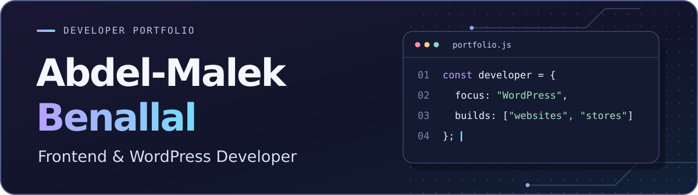
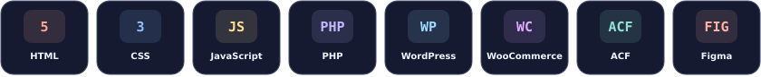
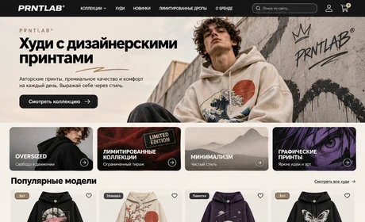

  

  
  

<a href="README.ru.md">Читать на русском</a>

## About me

I’m a freelance frontend and WordPress developer. I turn design mockups into responsive websites and build WordPress themes that clients can update themselves. I also develop WooCommerce storefronts with custom product pages, carts, and checkout flows.

## Tech stack

## Selected projects

| Preview | Project |
| :--- | :--- |
|  | **[Nihon](https://github.com/Benallal-Malek/nihon-landing)** · Japanese language school landing page. Responsive layout, mobile navigation, and a demo signup form. `HTML` `CSS` `JavaScript` |
|  | **[PRNTLAB](https://github.com/Benallal-Malek/prntlab-woocommerce-theme)** · WooCommerce theme for a hoodie store. Variable products, editable sections, and a demo importer. `WordPress` `WooCommerce` `ACF` `PHP` |

## Activity

[Browse my repositories](https://github.com/Benallal-Malek?tab=repositories)

