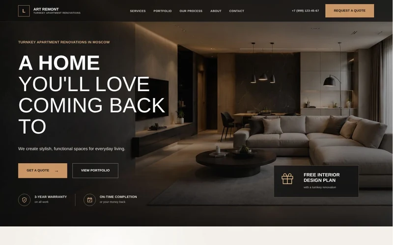
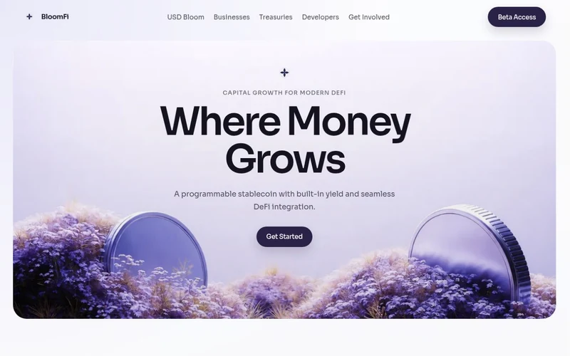
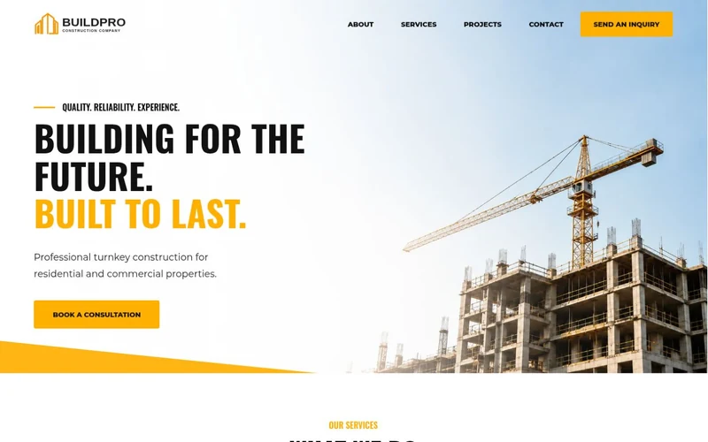
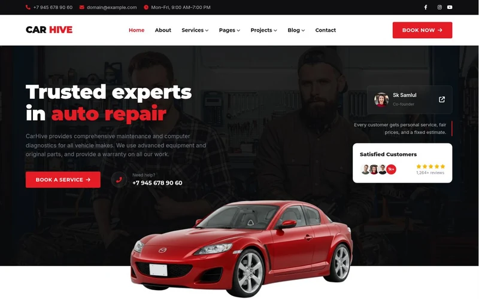
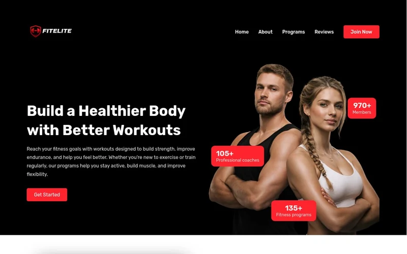
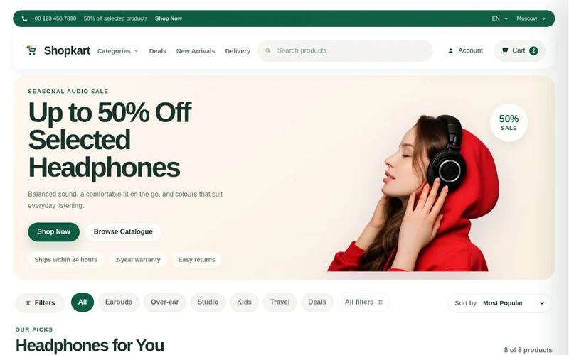
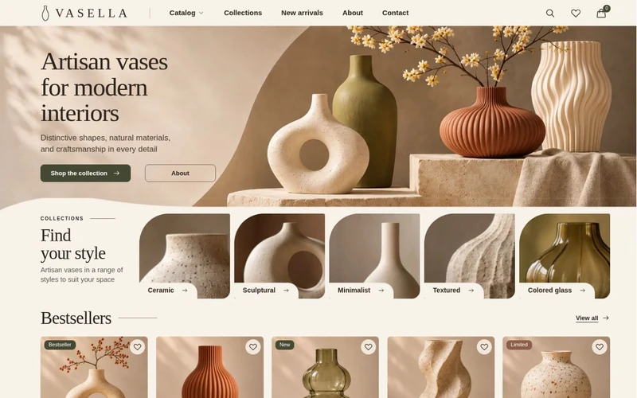

  

  
  
  

<a href="README.ru.md">Читать на русском</a>

## About me

I’m a freelance frontend and WordPress developer. I turn design mockups into responsive websites and build WordPress themes that clients can update themselves. I also develop WooCommerce storefronts with custom product pages, carts, and checkout flows.

## Tech stack

## Selected projects

| Preview | Project |
| :--- | :--- |
|  | **[Nihon](https://github.com/Benallal-Malek/nihon-landing)** · Japanese language school landing page. Responsive layout, mobile navigation, and a demo signup form. `HTML` `CSS` `JavaScript` |
|  | **[PRNTLAB](https://github.com/Benallal-Malek/prntlab-woocommerce-theme)** · WooCommerce theme for a hoodie store. Variable products, editable sections, and a demo importer. `WordPress` `WooCommerce` `ACF` `PHP` |

<strong>Read more</strong> · 9 website projects

**[Website Portfolio](https://benallal-malek.github.io/website-portfolio/)** · Nine English-language demos with [source files](https://github.com/Benallal-Malek/website-portfolio).

| Preview | Project |
| :--- | :--- |
|  | **Art Remont** · Interior renovation landing page with project galleries and an estimate form. [Live demo](https://benallal-malek.github.io/website-portfolio/projects/art-remont/) · [Source code](https://github.com/Benallal-Malek/website-portfolio/tree/main/projects/art-remont/) |
|  | **BloomFi** · Investment landing page with service and portfolio sections. [Live demo](https://benallal-malek.github.io/website-portfolio/projects/bloomfy/) · [Source code](https://github.com/Benallal-Malek/website-portfolio/tree/main/projects/bloomfy/) |
|  | **BuildPro** · Construction company website with services and an inquiry form. [Live demo](https://benallal-malek.github.io/website-portfolio/projects/buildpro/) · [Source code](https://github.com/Benallal-Malek/website-portfolio/tree/main/projects/buildpro/) |
|  | **CarHive** · Auto repair and detailing website with service cards and animated counters. [Live demo](https://benallal-malek.github.io/website-portfolio/projects/carhive/) · [Source code](https://github.com/Benallal-Malek/website-portfolio/tree/main/projects/carhive/) |
|  | **Cars** · Premium car rental catalog with brand filters and a booking form. [Live demo](https://benallal-malek.github.io/website-portfolio/projects/cars/) · [Source code](https://github.com/Benallal-Malek/website-portfolio/tree/main/projects/cars/) |
|  | **Fite Lite** · Fitness studio landing page with programs and a testimonials carousel. [Live demo](https://benallal-malek.github.io/website-portfolio/projects/fite-lite/) · [Source code](https://github.com/Benallal-Malek/website-portfolio/tree/main/projects/fite-lite/) |
|  | **Shopkart** · Headphone catalog with search, sorting, filters, and favorites. [Live demo](https://benallal-malek.github.io/website-portfolio/projects/head-phones/) · [Source code](https://github.com/Benallal-Malek/website-portfolio/tree/main/projects/head-phones/) |
|  | **Inner Balance** · Therapist landing page with service descriptions and a consultation form. [Live demo](https://benallal-malek.github.io/website-portfolio/projects/iner-balance/) · [Source code](https://github.com/Benallal-Malek/website-portfolio/tree/main/projects/iner-balance/) |
|  | **Vasella** · Artisan vase shop with a searchable catalog, favorites, and a demo cart. [Live demo](https://benallal-malek.github.io/website-portfolio/projects/vasella/) · [WordPress theme](https://github.com/Benallal-Malek/vasella-woocommerce-theme) |

## Activity

[Browse my repositories](https://github.com/Benallal-Malek?tab=repositories)

